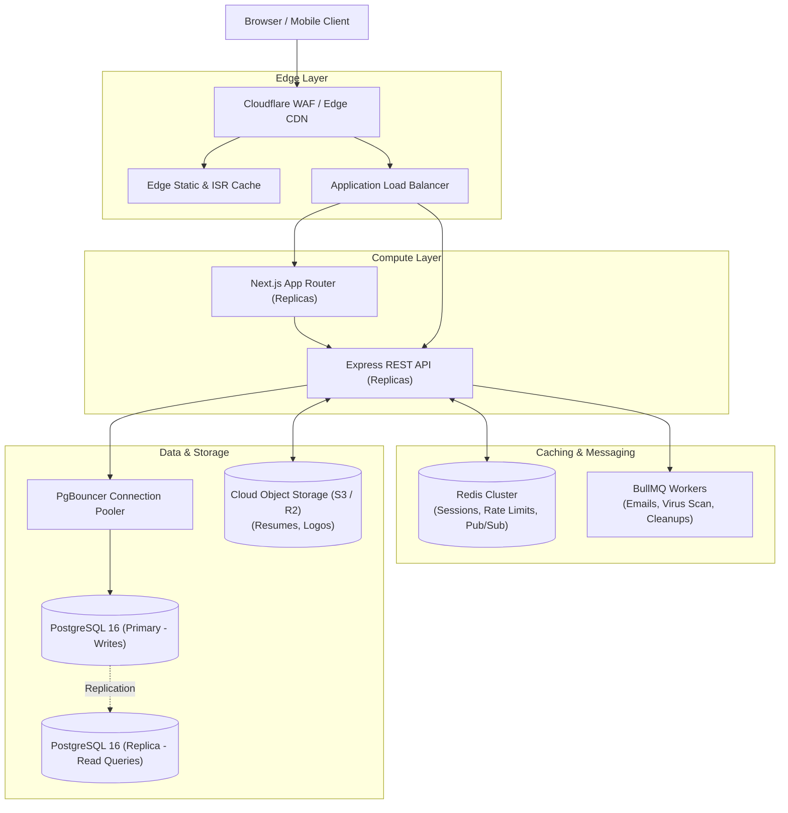

# Jobify: Architectural Suggestions, Production Readiness Audit & Feature Roadmap

This document provides a comprehensive technical audit of the **Jobify** platform. It outlines critical blockers that must be resolved before commercial production deployment, high-value feature enhancements for enterprise competitiveness, and architectural patterns to scale the platform to millions of jobs, candidates, and real-time hiring workflows.

---

## 1. Executive Summary & Production Readiness Scorecard

Jobify currently features a solid, secure foundation:
- **Authentication**: Argon2id password hashing, database-backed server-side sessions with SHA-256 tokens, SameSite cookies, and custom CSRF header validation.
- **Core Modules**: RBAC enforcement for Candidates, Employers, and Admins; strict company verification gates; atomic application state transitions; and ownership checks against IDOR vulnerabilities.
- **Frontend**: Next.js 15 App Router, TanStack Query, React Hook Form, and a modern tactile Soft-UI/Neumorphic design system.

However, to transition from a single-node demonstration application to an enterprise-grade, high-availability, and compliant SaaS product, several operational and architectural gaps must be addressed.

### Production Readiness Scorecard

| Domain | Current State | Production Target | Status |
|:---|:---|:---|:---:|
| **File Storage** | Local filesystem (`uploads/`) | Cloud Object Storage (S3 / Cloudflare R2 / GCS) + CDN | ⚠️ Blocked |
| **File Security** | Magic-bytes check (`%PDF`), 5MB limit | Async virus/malware scanning (ClamAV) + PDF sanitization | ⚠️ Blocked |
| **Session & Cache** | Direct PostgreSQL session queries | Distributed Redis cache + cache-aside session store | ⚠️ Scalability Risk |
| **Async Processing** | Synchronous HTTP request cycle | Asynchronous Message Queue (BullMQ / SQS) | ⚠️ Scalability Risk |
| **Search Engine** | Prisma `ILIKE` / substring matching | PostgreSQL Full-Text (`tsvector`) or Meilisearch + pgvector | 🟡 Recommended |
| **Communications** | None | Transactional email (Resend / SendGrid) + SSE/WebSockets | ⚠️ User Friction |
| **Database Pool** | Direct Prisma connection pool | PgBouncer / Supavisor connection multiplexing | ⚠️ Scalability Risk |
| **Observability** | `console.log` / `console.error` | Structured JSON (Pino) + Sentry APM + OpenTelemetry | ⚠️ Reliability Risk |
| **Compliance** | Basic cascade deletes | GDPR PII purge, data export (Art. 20), and audit trails | 🟡 Compliance Gap |

---

## 2. Critical Production Gaps (Must-Fix Before Launch)

### 2.1 Cloud Object Storage & Edge CDN
- **Problem**: Resumes and logos are currently written to local disk in `backend/uploads/`. In cloud container environments (Docker Swarm, Kubernetes, AWS ECS, Railway, Render), containers are ephemeral. Scaling beyond 1 instance causes uploads saved on Node A to return 404 when requested on Node B.
- **Solution**:
  - Implement an AWS S3 / Cloudflare R2 driver implementing the existing `StorageProvider` interface (`src/modules/files/storage/`).
  - Generate short-lived (e.g. 15-minute) presigned download URLs for authorized resume views instead of streaming multi-megabyte payloads through the Express event loop.
  - Serve company logos through an image CDN (Cloudflare Images, Imgix, or S3 + CloudFront) with automatic WebP/AVIF transformation and aggressive edge caching.

### 2.2 Malware & Antivirus Scanning for Uploads
- **Problem**: PDFs are verified using magic bytes (`%PDF-`), but malicious PDFs can contain embedded JavaScript, malicious xref streams, or zero-day parser exploits.
- **Solution**:
  - Quarantine uploaded files immediately upon ingestion.
  - Trigger an asynchronous background scan via ClamAV (containerized daemon) or AWS GuardDuty before marking `StoredFile.status = VERIFIED`.
  - Strip active content and JavaScript scripts from PDFs before allowing hiring managers to view or download them.

### 2.3 Distributed Redis Caching & Session Offloading
- **Problem**: Every authenticated HTTP request executes a database query (`SELECT * FROM "Session" WHERE token_hash = ...`). At high traffic (e.g. 5,000 req/sec), PostgreSQL connection limits and disk I/O are saturated by routine session verification.
- **Solution**:
  - Introduce Redis as a fast in-memory session cache with automatic TTL expiration matching the session max-age (7 days).
  - Adopt a **Cache-Aside pattern**: check Redis for `session:<token_hash>`; on miss, query PostgreSQL, populate Redis, and continue.
  - Invalidate the Redis key immediately on logout, password reset, or admin suspension.

### 2.4 Transactional Email & Lifecycle Notifications
- **Problem**: The system currently does not send emails. In a real recruitment platform, emails are essential for conversion, trust, and responsiveness.
- **Solution**:
  - Integrate a transactional email engine (Resend, AWS SES, or Postmark).
  - Implement template-driven notifications for:
    - Candidate email verification and password reset workflows.
    - Application submission confirmation to the applicant.
    - Real-time alert to the employer when a new application is submitted.
    - Status change alerts to candidates (e.g. *"TechFlow has moved your application to SHORTLISTED"*).
    - Employer weekly digests (views, applicant volume, open drafts).

### 2.5 Background Asynchronous Job Queue (BullMQ)
- **Problem**: Sending emails, processing resume uploads, generating analytics, and checking job deadline expirations inside the HTTP request loop introduces latency and risks HTTP 504 timeouts.
- **Solution**:
  - Deploy **BullMQ** on top of Redis.
  - Offload heavy tasks to background workers:
    - `send-email-queue`: Handles all transactional deliveries with automated exponential backoff retries.
    - `file-processing-queue`: Virus scanning, thumbnail generation, and text extraction.
    - `scheduler-cron`: Daily scheduled tasks (closing jobs past `applicationDeadline`, invalidating expired sessions).

### 2.6 Database Connection Pooling & Read Replicas
- **Problem**: Prisma establishes direct persistent TCP connections to PostgreSQL. If backend containers scale horizontally (e.g. from 2 to 20 instances), PostgreSQL quickly hits its `max_connections` ceiling.
- **Solution**:
  - Deploy **PgBouncer** (or AWS RDS Proxy / Supavisor) in transaction-pooling mode.
  - Configure Prisma with connection limits tuned to pooler capacity.
  - Add PostgreSQL **Read Replicas** for read-heavy operations (public job catalog search, company directory, and static pages), reserving the primary database instance for writes (auth, applications, status transitions).

### 2.7 Observability, APM & Structured Logging
- **Problem**: `console.log` output is unstructured, difficult to parse in log aggregators (Elasticsearch / Datadog / CloudWatch), and lacks distributed request correlation IDs.
- **Solution**:
  - Replace console logging with **Pino**: structured JSON logging with millisecond timestamps, log levels (`info`, `warn`, `error`), and `req.id` tracing across every request.
  - Add **Sentry** or Datadog for exception tracking, sourcemap resolution, and client/server error breadcrumbs.
  - Implement Prometheus metric scrapers (`prom-client`) exposing `/metrics` (HTTP request latency histograms, status codes, DB query durations, active session counts).

---

## 3. High-Impact Feature Roadmap

### 3.1 AI-Powered Candidate Matching & Resume Parser
- **Concept**: Bridge the gap between job descriptions and resume text using machine learning.
- **Implementation**:
  - Extract raw text from uploaded PDF resumes using `pdf-parse` or Tesseract OCR.
  - Run structured entity extraction (via OpenAI / Anthropic / Google Gemini API or lightweight local models):
    - Normalized Skills (e.g. `['TypeScript', 'PostgreSQL', 'Docker', 'Next.js']`).
    - Years of Experience & Seniority Level.
    - Education and Degree classifications.
  - **Vector Semantic Search**: Generate text embeddings for job requirements and applicant profiles using `pgvector` in PostgreSQL. Compute cosine similarity scores (e.g. *"92% Match"*), helping hiring teams prioritize top matches instantly.

### 3.2 Real-Time In-App Messaging (Candidate ↔ Recruiter)
- **Concept**: Eliminate slow external email ping-pong by allowing direct communication once a candidate is shortlisted.
- **Implementation**:
  - Establish a WebSocket gateway (Socket.io / ws) backed by Redis Pub/Sub for horizontal scalability.
  - Restrict chat activation: only available when an application is in `REVIEWING`, `SHORTLISTED`, or `ACCEPTED` states.
  - Support message threads, typing indicators, read receipts, and file attachment sharing.

### 3.3 Native Interview Scheduling & Calendar Integration
- **Concept**: Empower recruiters to schedule screening calls and technical interviews directly in the portal.
- **Implementation**:
  - Calendar integration via Google Calendar API, Microsoft Graph API, or Cal.com embed API.
  - Employer defines recurring availability windows; candidate picks an open slot.
  - Automatic generation of Google Meet / Zoom links embedded into the application detail view.

### 3.4 Multi-Stage Candidate Evaluation & Scorecards
- **Concept**: Enable interviewers and recruiters to collaborate on hiring decisions using structured evaluation rubrics.
- **Implementation**:
  - Custom scorecards per company (Technical Skills, Culture Fit, Problem Solving, Communication).
  - Rating scales (1 to 5 stars) with mandatory written justification.
  - Aggregated score averaging visible to hiring managers to eliminate hiring bias.

### 3.5 Custom Application Screener Questions
- **Concept**: Prevent unqualified application influx by allowing employers to define pre-screening questions.
- **Implementation**:
  - Add `JobScreeningQuestion` model (Types: `TEXT`, `BOOLEAN`, `NUMBER`, `SELECT`).
  - Example: *"Do you have at least 3 years of production Go experience?"*, *"Do you require visa sponsorship?"*.
  - Candidate fills answers during modal apply; automated knock-out filters can auto-reject applicants who do not meet mandatory criteria.

### 3.6 Social Auth & Enterprise Single Sign-On (SSO)
- **Concept**: Frictionless registration for developers and enterprise security for corporate employers.
- **Implementation**:
  - **Candidates**: OAuth 2.0 / OpenID Connect (Sign in with Google, GitHub, LinkedIn).
  - **Employers**: SAML 2.0 / Okta / Azure AD SSO for enterprise company accounts.

---

## 4. Architectural & System Design Improvements



### 4.1 Search Engine Evolution
- **Current State**: Prisma `findMany` using `contains` with `mode: 'insensitive'`.
- **Level 1 Evolution (In-DB Full-Text Search)**:
  - Add PostgreSQL `tsvector` column on `Job` table indexing `title`, `description`, `skills`, and `company.name`.
  - Create GIN index (`CREATE INDEX idx_jobs_search ON "Job" USING GIN(search_vector)`).
  - Enables stemming (e.g. `running` matches `run`), ranked relevance scores (`ts_rank`), and sub-millisecond query performance.
- **Level 2 Evolution (Dedicated Search Cluster)**:
  - Integrate **Meilisearch** or **Elasticsearch**.
  - Provides instant typo tolerance (e.g. `pythn` -> `python`), faceted counts, and custom ranking weights (boost verified companies and featured jobs).

### 4.2 Database Partitioning & Archiving
- As the platform scales to hundreds of thousands of applications and sessions:
  - **Session Partitioning**: Range partition the `Session` table by `expiresAt` or use Redis TTL exclusively to prevent table bloat.
  - **Audit Partitioning**: Partition `AuditLog` by month/year for compliance archiving and performant historical reporting.
  - **Soft-Delete vs Cold Storage**: Move jobs and applications closed > 12 months into archival cold storage (Postgres cold partition or Parquet files on S3) to maintain fast index B-trees on active records.

### 4.3 Content Security Policy & Security Hardening
- Strengthen HTTP response headers in `helmet`:
  ```typescript
  app.use(
    helmet({
      contentSecurityPolicy: {
        directives: {
          defaultSrc: ["'self'"],
          scriptSrc: ["'self'", "'unsafe-inline'"],
          styleSrc: ["'self'", "'unsafe-inline'"],
          imgSrc: ["'self'", "data:", "https://*.s3.amazonaws.com"],
          connectSrc: ["'self'", "https://api.jobify.dev"],
        },
      },
      crossOriginEmbedderPolicy: false,
    })
  );
  ```
- Implement **Two-Factor Authentication (2FA)** via TOTP (RFC 6238, Google Authenticator) for admin and employer accounts to safeguard sensitive hiring data.

---

## 5. Compliance, Governance & Data Privacy (GDPR / CCPA)

Recruitment platforms manage highly sensitive Personally Identifiable Information (PII) including full names, physical addresses, compensation expectations, work authorizations, and employment histories.

1. **Right to Erasure (GDPR Article 17)**:
   - Provide candidates an automated *"Delete My Account & Data"* mechanism that purges profiles, deletes resume files from S3, and anonymizes application records so historical employer analytics remain mathematically accurate without retaining PII.
2. **Data Portability (GDPR Article 20)**:
   - Candidate can download a single archive (`profile-export.json` + resumes) containing all personal data stored across the platform.
3. **Automated Resume Retention Lifecycle**:
   - Regulatory policy: Automatically purge resumes of rejected applicants after 180 or 365 days unless explicit consent for a candidate talent pool is renewed.
4. **Access Audit Trails**:
   - Maintain immutable records of which recruiters and administrators opened or downloaded a candidate's resume, protecting the platform from insider leakage and unauthorized surveillance.

---

## 6. Recommended Implementation Priority Matrix

```
   High Impact
        │
        │    [Cloud Object Storage]        [AI Match & Resume Parser]
        │    [Redis Sessions & Cache]      [Real-Time Messaging]
        │    [Transactional Emails]        [Interview Scheduler]
        │
        │    [PgBouncer & Replicas]        [Audit Logs & GDPR Purge]
        │    [ClamAV PDF Scanner]          [Full-Text Search Engine]
        │    [Pino & Sentry APM]           [Enterprise SSO]
        │
        └─────────────────────────────────────────────────────────────► High Effort
             Low Effort
```

### Phase 1: Operational Stability & Cloud Scale (Immediate)
1. Replace `LocalStorage` with **AWS S3 / Cloudflare R2** StorageProvider.
2. Introduce **Redis** for distributed session validation and rate-limiting.
3. Integrate **Resend / AWS SES** transactional email delivery for auth and application lifecycle.
4. Add **Pino** structured logging and **Sentry** exception monitoring.

### Phase 2: Search & Platform Intelligence (Short-Term)
1. Upgrade job catalog search to PostgreSQL **`tsvector` + GIN** full-text search.
2. Add **BullMQ** worker queues for asynchronous email delivery and file processing.
3. Deploy **PgBouncer** connection pooler.
4. Implement **Candidate Resume Parser** & automatic skill tag extraction.

### Phase 3: Collaborative Enterprise Hiring Suite (Long-Term)
1. Add **Real-time candidate chat** via WebSockets.
2. Implement **Interview Scheduling** with Google Calendar integration.
3. Deliver **Multi-member Candidate Scorecards** and evaluation rubrics.
4. Build **Enterprise SSO** (SAML / Okta) and GDPR Data Privacy self-service portal.
